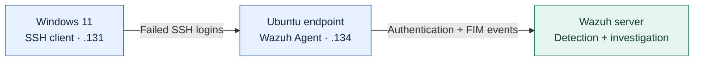
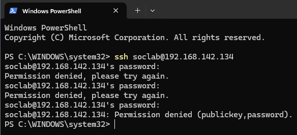
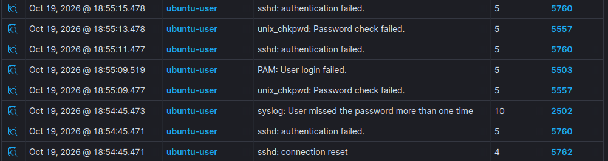
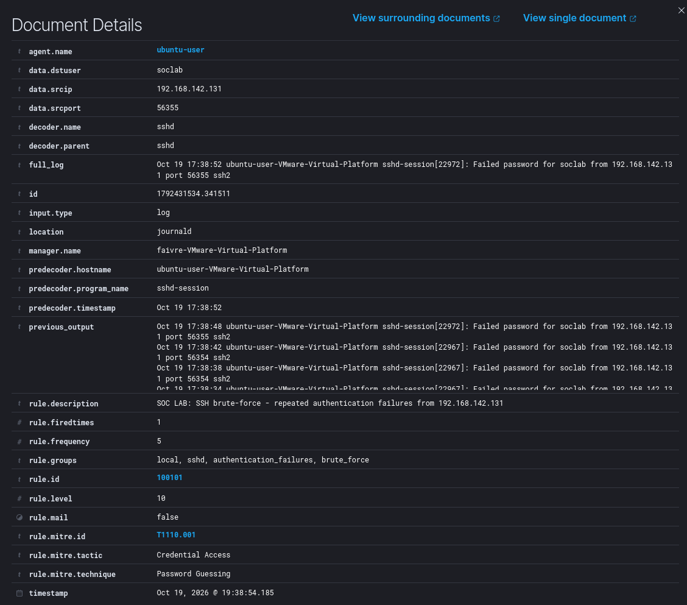
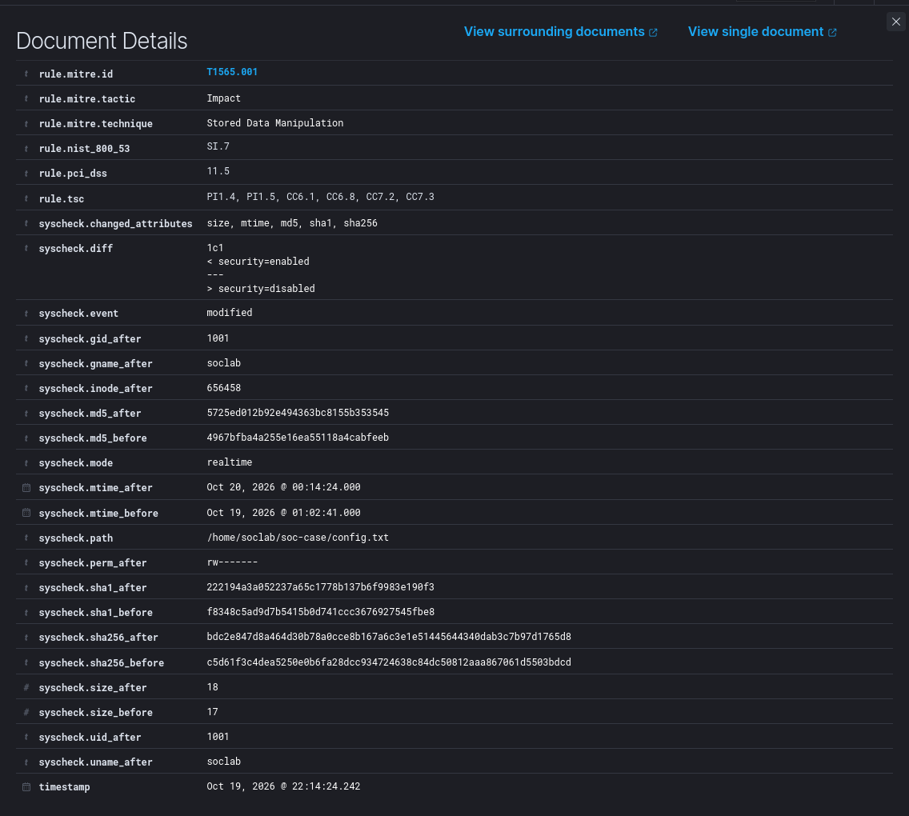

# SOC-001 · SSH Brute Force Detection

**A Wazuh home lab: simulate an attack, investigate the logs, and build a working detection.**

I built a three-VM security monitoring lab to practice the work behind a SOC alert. Starting with repeated failed SSH logins, I traced the activity through Linux logs, wrote a custom Wazuh rule, and confirmed it produced a live alert. I also tested file integrity monitoring by changing a configuration file and inspecting the recorded diff.

**Tools:** Wazuh · Ubuntu · Windows 11 · VMware Workstation · OpenSSH  
**Skills:** log analysis · detection engineering · alert investigation · file integrity monitoring

## The setup

A Windows VM generated SSH attempts against an Ubuntu endpoint. The Linux agent sent authentication and file-change events to an Ubuntu server running Wazuh Manager, Indexer, and Dashboard. Everything ran on my VMware lab network.



Lab subnet: `192.168.142.0/24`. An initial UFW block was resolved by allowing SSH from that subnet. [Architecture details →](docs/architecture.md)

## From failed logins to useful evidence

From Windows PowerShell, I connected to the test account and repeatedly entered incorrect passwords:

```powershell
ssh soclab@192.168.142.134
```



The failures appeared in the Linux systemd journal and Wazuh Threat Hunting. The key detail was the matching rule: **`5760`, not `5716`, identified individual failures in this environment.** That gave me the right starting point for correlation.



## Building and validating the detection

I created rule **`100101`** to correlate repeated `5760` events from the same source IP, using `frequency="5"` within 20 seconds and alert level 10. It maps to **MITRE ATT&CK T1110.001 — Password Guessing**.

Wazuh already includes brute-force detection; my lab notes also recorded built-in rule `5763`. The custom rule let me practice choosing a correlation source and experimenting with a short detection window.

After configuration checks and testing, the custom alert appeared in the dashboard. It identifies the source IP, target account, and preceding failures—confirming live alert delivery beyond a logtest result.



[View the XML rule](rules/ssh-bruteforce.xml) · [Validation commands and test notes](cases/SOC-001-ssh-bruteforce.md)

## Investigating a file change

For a separate FIM exercise, I monitored `/home/soclab/soc-case/` and changed `config.txt` from `security=enabled` to `security=disabled`.

Wazuh generated an integrity-change event. Its details showed changed hashes, file size, and the exact text change in `syscheck.diff`:



SSH detection and FIM worked independently. Linking those events would require timeline investigation; no automatic multi-stage correlation was configured.

## What I learned

The most useful lesson was to build detections from the events actually arriving. Checking the matching rule, decoded source IP, and live alert mattered as much as writing the XML.

This lab also made the limits clear: password mistakes can trigger alerts, slow or distributed guessing can evade a short same-IP window, and failed logins do not prove compromise. A file-change event shows what changed, but ownership alone does not identify who changed it.

Next, I want to explore Windows persistence detection, automated response, and Linux audit logging.

---

Part of my **SOC Detection Lab**. All activity was simulated on personally managed VMs.

[Technical notes](cases/SOC-001-ssh-bruteforce.md) · [Evidence and screenshots](docs/evidence.md) · [FIM configuration](configs/fim-syscheck.xml) · [MIT License](LICENSE)
