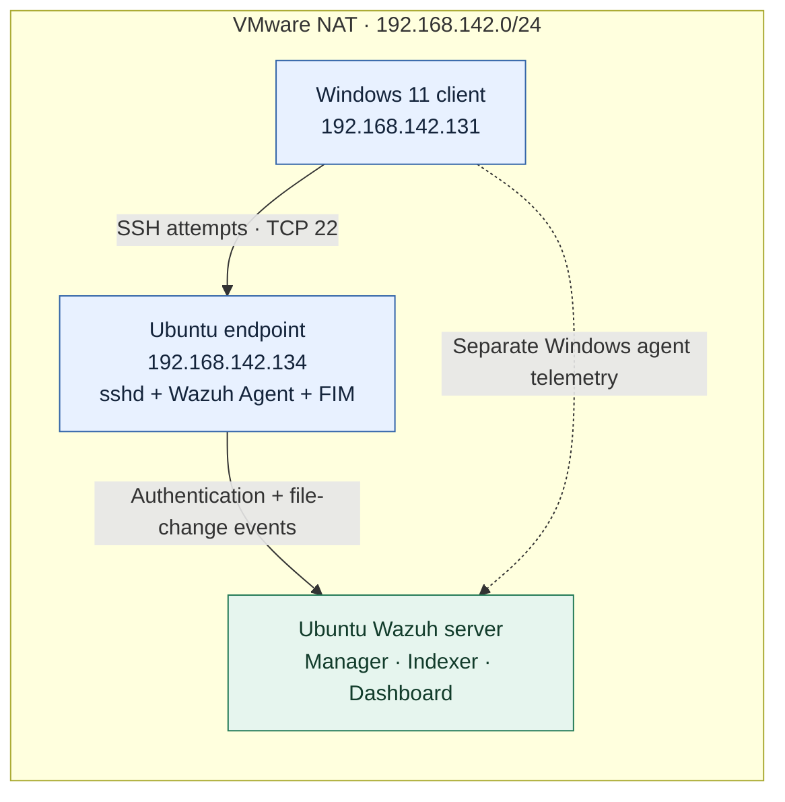

# SOC Detection Lab

**From authentication failures to detection logic and file-change investigation.**

A personal security monitoring lab built with Wazuh in VMware Workstation. The first case follows a controlled SSH password-guessing simulation, investigation of Linux authentication events, a custom correlation rule, and a separate file integrity monitoring exercise.

**Stack:** Wazuh SIEM · Ubuntu Linux · Windows 11 · OpenSSH · VMware Workstation · MITRE ATT&CK

## Lab at a glance

SSH authentication evidence originates on the **Linux endpoint**. The Windows machine supplies the test traffic; its agent is not the source of these SSH detections. [Architecture details →](docs/architecture.md)

## Case studies

| Case | Investigation | Status |
|---|---|---|
| [SOC-001](cases/SOC-001-ssh-bruteforce.md) | SSH brute force, custom detection, and FIM | Lab exercise completed; documented from lab notes |

**Key finding:** individual SSH failures matched rule `5760` in this environment, and Wazuh's existing brute-force rule `5763` was also observed. The custom rule explores correlation thresholds; it does not fill a claimed absence of built-in detection.

> **Evidence scope:** the repository contains the supplied lab log excerpt and reconstructed configuration samples. Screenshots, raw alert exports, and validation transcripts were not available at publication. Custom manager-alert delivery and exact triggering counts remain unverified here. See the [evidence register](docs/evidence.md).

## Skills demonstrated

- Configuring a multi-VM monitoring environment and troubleshooting SSH connectivity.
- Investigating authentication events and selecting correlation rules from observed matches.
- Developing Wazuh XML rules with source-IP correlation and ATT&CK mapping.
- Configuring FIM and separating suspicious activity from proof of compromise.
- Explaining validation boundaries, false positives, and detection gaps.

## Explore the repository

[Technical case](cases/SOC-001-ssh-bruteforce.md) · [Custom rule](rules/ssh-bruteforce.xml) · [FIM configuration](configs/fim-syscheck.xml) · [Evidence register](docs/evidence.md)

## Potential extensions

These are ideas, **not completed cases**:

- **SOC-002:** Windows persistence detection.
- **SOC-003:** Automated threat response.
- **SOC-004:** Linux audit and suspicious command execution.

All activity described was a controlled simulation on personally managed lab VMs. No real-world breach or automated response is claimed.

[MIT License](LICENSE)
