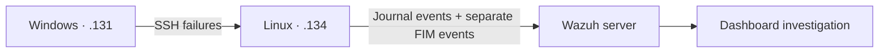

# SOC-001: SSH Brute Force Detection & Investigation

**Environment:** personal VMware lab · **Technique:** T1110.001 · **Focus:** authentication, correlation, file integrity

> Evidence note: this case reconstructs a completed exercise from the lab owner's notes. The log excerpt and configuration were supplied; screenshots, alert exports, and test transcripts were not. Reported observations are distinguished from independently verifiable results.

## 1. Objective

Investigate repeated unsuccessful SSH authentication, identify the matching Wazuh rules, and develop a source-IP correlation rule. A separate file modification exercise explored how FIM could support investigation after suspicious authentication activity. All activity was simulated on personally managed VMs; no successful intrusion was established.

## 2. Lab Architecture

Three VMs shared VMware NAT subnet `192.168.142.0/24`: an Ubuntu Wazuh server, an Ubuntu endpoint, and a Windows 11 endpoint. Both endpoints had operational Wazuh Agents.



Linux hostname: `ubuntu-user-VMware-Virtual-Platform`. Windows agent: `WIN11ENTP-SOC-LAB`. The administrative account was `ubuntu-user`; the test account was `soclab`. UFW initially blocked SSH, resolved by allowing TCP 22 from the lab subnet. [Full architecture](../docs/architecture.md).

## 3. Attack Simulation

From Windows PowerShell:

```powershell
ssh soclab@192.168.142.134
```

Incorrect passwords were repeatedly entered to generate failed authentication. Windows supplied the SSH traffic; **Linux recorded the relevant authentication events**. The exact attempt count and timing were not retained in the supplied material.

## 4. Log Investigation

Example systemd journal entry supplied from the lab:

```text
sshd-session[19112]: Failed password for soclab from 192.168.142.131 port 49791 ssh2
```

This identifies the target account, source IP, and client source port. It indicates a failed password check, not a successful session. The excerpt has no timestamp, so it cannot establish a precise timeline alone.

The lab notes report these matches in Wazuh Threat Hunting:

| Rule | Reported description |
|---|---|
| `5760` | sshd: authentication failed. |
| `5763` | sshd: brute force trying to get access to the system. Authentication failed. |
| `2502` | syslog: User missed the password more than one time |
| `5557` | unix_chkpwd: Password check failed. |
| `5503` | PAM: User login failed. |

The useful discovery was that **`5760`, rather than `5716`, matched individual failures in this environment**. Correlation therefore used the observed rule. The reported `5763` matches also showed that built-in brute-force detection was already present. Related PAM and SSH records should not automatically be counted as distinct password attempts.

## 5. Detection Engineering

The supplied rule was placed in `/var/ossec/etc/rules/local_rules.xml` on the manager. A reusable copy is in [rules/ssh-bruteforce.xml](../rules/ssh-bruteforce.xml).

```xml
<group name="local,sshd,">

  <rule id="100101" level="10" frequency="5" timeframe="20">
    <if_matched_sid>5760</if_matched_sid>
    <same_srcip />
    <description>SOC LAB: SSH brute-force - repeated authentication failures from $(srcip)</description>
    <mitre>
      <id>T1110.001</id>
    </mitre>
    <group>authentication_failures,brute_force,</group>
  </rule>

</group>
```

Rule `100101` uses prior `5760` matches and the same decoded source IP, with `frequency="5"`, a 20-second window, and alert level 10. The short window supports a compact manual burst experiment; it is a lab setting, not a production-tuned threshold. No baseline or threshold comparison was supplied.

The configuration describes event correlation, not a verified number of password prompts needed to trigger. Confirm actual behavior against the installed version and retained event sequence. See [Wazuh rule syntax](https://documentation.wazuh.com/current/user-manual/ruleset/ruleset-xml-syntax/rules.html).

The ATT&CK mapping is [T1110.001 — Password Guessing](https://attack.mitre.org/techniques/T1110/001/). The custom rule was a detection-engineering exercise alongside built-in detection.

## 6. Testing & Validation

The lab notes record this manager workflow:

```bash
sudo /var/ossec/bin/wazuh-analysisd -t
sudo systemctl restart wazuh-manager
sudo /var/ossec/bin/wazuh-logtest
```

The first command checks configuration; restart applies changes; logtest evaluates submitted events. A logtest match alone does not establish live collection or dashboard delivery. These commands were documented, not executed during repository preparation.

| Validation layer | Available result |
|---|---|
| Positive SSH simulation | Failures and built-in matches reported; one log excerpt supplied |
| Configuration validation | Command supplied; output unavailable |
| Custom rule evaluation | Successful practical testing reported after troubleshooting; transcript unavailable |
| Live custom alert `100101` | No manager alert export supplied; delivery unverified here |
| Negative tests | No recorded results supplied |

The evidence does not distinguish a custom logtest success from a manager-generated alert. No exact triggering count is claimed. The [evidence register](../docs/evidence.md) lists follow-up positive and negative tests, including isolated failures, slow attempts, and multiple sources.

## 7. File Integrity Monitoring

The Linux agent monitored a dedicated test directory using this entry inside its `syscheck` configuration:

```xml
<directories check_all="yes" realtime="yes" report_changes="yes">/home/soclab/soc-case</directories>
```

The reported exercise changed `/home/soclab/soc-case/config.txt` from:

```ini
security=enabled
```

to:

```ini
security=disabled
```

These are test-file contents, not proof that a real security control was disabled.

FIM compares recorded file attributes and cryptographic hashes to identify changes. Metadata such as size, permissions, ownership, and modification time adds context; hashes indicate content changes without explaining their cause. See the [syscheck configuration reference](https://documentation.wazuh.com/current/user-manual/reference/ossec-conf/syscheck.html).

With `report_changes` enabled, supported text changes can appear in `syscheck.diff`. No event, hash values, or actual diff was supplied, so none is presented as observed evidence. See [Wazuh's file-change reporting documentation](https://documentation.wazuh.com/current/user-manual/capabilities/file-integrity/use-cases/reporting-file-changes.html).

SSH correlation and FIM are **separate detection mechanisms**. Connecting them requires investigation of host identity and timestamps; no automatic multi-stage correlation was configured. The supplied material does not establish a causal link.

## 8. Detection Limitations

- Legitimate password mistakes or stale credentials can produce false positives.
- Slow guessing outside the time window and distributed sources can evade this correlation.
- Missing collection, different rule matches, or absent decoded source IPs can cause false negatives.
- Authentication failures do not prove compromise; successful-session evidence would be needed.
- FIM changes alone do not reliably identify the responsible user. Additional audit evidence would be needed.
- Built-in and custom detections can overlap; additional alerts are not automatically additional coverage.

## 9. Lessons Learned

Observed events were more useful than assumed rule IDs. Connectivity troubleshooting preceded meaningful detection testing. Custom XML made correlation parameters explicit, while FIM added a separate view of endpoint changes.

The next improvement is evidence retention: record versions, timestamped inputs, negative tests, and both logtest and live alerts. Then assess thresholds against normal authentication activity and build a timeline without treating temporal proximity as proof of causation.

[Back to project](../README.md)
