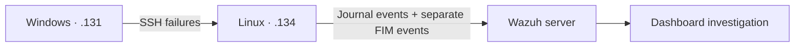

# SOC-001: SSH Brute Force Detection & Investigation

**Environment:** personal VMware lab · **Technique:** T1110.001 · **Focus:** authentication, correlation, file integrity

> Evidence: original screenshots document SSH failures, a live custom alert, and a FIM event with a text diff. Configuration and workflow details also draw on lab notes. Raw alert exports and logtest transcripts are not included; see the [evidence register](../docs/evidence.md).

## 1. Objective

Investigate repeated unsuccessful SSH authentication, identify the matching Wazuh rules, and develop a source-IP correlation rule. A separate file modification exercise explored how FIM could support investigation after suspicious authentication activity. All activity was simulated on personally managed VMs; no successful intrusion was established.

## 2. Lab Architecture

Three VMs shared VMware NAT subnet `192.168.142.0/24`: an Ubuntu Wazuh server, an Ubuntu endpoint, and a Windows 11 endpoint. Both endpoints had operational Wazuh Agents.



Linux hostname: `ubuntu-user-VMware-Virtual-Platform`. Windows agent: `WIN11ENTP-SOC-LAB`. The administrative account was `ubuntu-user`; the test account was `soclab`. UFW initially blocked SSH, resolved by allowing TCP 22 from the lab subnet. [Full architecture](../docs/architecture.md).

## 3. Attack Simulation

From Windows PowerShell:

```powershell
ssh soclab@192.168.142.134
```

Incorrect passwords were repeatedly entered to generate failed authentication. Windows supplied the SSH traffic; **Linux recorded the relevant authentication events**. The full triggering sequence was not retained.


The capture shows a rejected SSH connection with repeated password prompts; passwords are not displayed.

## 4. Log Investigation

Example systemd journal entry supplied from the lab:

```text
sshd-session[19112]: Failed password for soclab from 192.168.142.131 port 49791 ssh2
```

This identifies the target account, source IP, and client source port. It indicates a failed password check, not a successful session. The excerpt has no timestamp; the separate journal capture below includes local event times.


Threat Hunting shows the authentication-related matches below. Rule `5763` was reported in the lab notes but is not visible in the supplied captures.

| Rule | Description |
|---|---|
| `5760` | sshd: authentication failed. |
| `5763` | sshd: brute force trying to get access to the system. Authentication failed. |
| `2502` | syslog: User missed the password more than one time |
| `5557` | unix_chkpwd: Password check failed. |
| `5503` | PAM: User login failed. |

The useful discovery was that **`5760`, rather than `5716`, matched individual failures in this environment**. Correlation therefore used the observed rule. The reported `5763` matches also showed that built-in brute-force detection was already present. Related PAM and SSH records should not automatically be counted as distinct password attempts.


The dashboard identifies the Linux agent as `ubuntu-user`; the raw logs retain its full hostname.

## 5. Detection Engineering

The supplied rule was placed in `/var/ossec/etc/rules/local_rules.xml` on the manager. A reusable copy is in [rules/ssh-bruteforce.xml](../rules/ssh-bruteforce.xml).

```xml
<group name="local,sshd,">

  <rule id="100101" level="10" frequency="5" timeframe="20">
    <if_matched_sid>5760</if_matched_sid>
    <same_srcip />
    <description>SOC LAB: SSH brute-force - repeated authentication failures from $(srcip)</description>
    <mitre>
      <id>T1110.001</id>
    </mitre>
    <group>authentication_failures,brute_force,</group>
  </rule>

</group>
```

Rule `100101` uses prior `5760` matches and the same decoded source IP, with `frequency="5"`, a 20-second window, and alert level 10. The short window supports a compact manual burst experiment; it is a lab setting, not a production-tuned threshold. No baseline or threshold comparison was supplied.

The configuration describes event correlation, not a verified number of password prompts needed to trigger. Confirm actual behavior against the installed version and retained event sequence. See [Wazuh rule syntax](https://documentation.wazuh.com/current/user-manual/ruleset/ruleset-xml-syntax/rules.html).

The ATT&CK mapping is [T1110.001 — Password Guessing](https://attack.mitre.org/techniques/T1110/001/). The custom rule was a detection-engineering exercise alongside built-in detection.

## 6. Testing & Validation

The lab notes record this manager workflow:

```bash
sudo /var/ossec/bin/wazuh-analysisd -t
sudo systemctl restart wazuh-manager
sudo /var/ossec/bin/wazuh-logtest
```

The first command checks configuration; restart applies changes; logtest evaluates submitted events. A logtest match alone does not establish live collection or dashboard delivery. These commands were documented, not executed during repository preparation.

### Positive test: live custom alert


This dashboard document confirms a manager-generated alert for `100101`, level `10`, source `192.168.142.131`, and destination user `soclab`. It includes the Linux agent, `journald` location, SSH decoder, previous failures, and ATT&CK mapping. This is evidence of live alert delivery, not merely logtest evaluation. Neither `rule.frequency` nor `rule.firedtimes` establishes the total number of password attempts made.

Configuration validation and logtest commands are documented above, but their output was not retained.

### Negative test: text-only procedure

No screenshot is included for the negative test. Its exact execution and observed outcome have not yet been documented. The repeatable procedure is to let prior correlation state expire, generate one failed SSH authentication, and inspect the matching time window for the same Linux agent and source IP. Confirm the base failure event (`5760`) was collected, then check for the absence of `100101`. This is the expected behavior for an isolated failure, not a recorded pass result. Additional slow-attempt and distributed-source tests remain future validation work.

## 7. File Integrity Monitoring

The Linux agent monitored a dedicated test directory using this entry inside its `syscheck` configuration:

```xml
<directories check_all="yes" realtime="yes" report_changes="yes">/home/soclab/soc-case</directories>
```

The file-change evidence confirms that the exercise changed `/home/soclab/soc-case/config.txt` from:

```ini
security=enabled
```

to:

```ini
security=disabled
```

These are test-file contents, not proof that a real security control was disabled.

FIM compares recorded file attributes and cryptographic hashes to identify changes. Metadata such as size, permissions, ownership, and modification time adds context; hashes indicate content changes without explaining their cause. See the [syscheck configuration reference](https://documentation.wazuh.com/current/user-manual/reference/ossec-conf/syscheck.html).

With `report_changes` enabled, supported text changes can appear in `syscheck.diff`. The captured event shows this exact change, mode `realtime`, changed size and modification time, and different MD5, SHA-1, and SHA-256 values. See [Wazuh's file-change reporting documentation](https://documentation.wazuh.com/current/user-manual/capabilities/file-integrity/use-cases/reporting-file-changes.html).


Rule `550`, level `7`, reports “Integrity checksum changed” for the Linux agent.


The event records the change from `security=enabled` to `security=disabled`, with file size increasing from 17 to 18 bytes.


Inventory confirms the monitored file and its recorded attributes. The `soclab` ownership fields do not establish who performed the edit.

SSH correlation and FIM are **separate detection mechanisms**. Connecting them requires investigation of host identity and timestamps; no automatic multi-stage correlation was configured. Displayed raw-log, event, and file times differ; timezone settings need reconciliation before building a precise timeline. These captures do not establish a causal link.

## 8. Detection Limitations

- Legitimate password mistakes or stale credentials can produce false positives.
- Slow guessing outside the time window and distributed sources can evade this correlation.
- Missing collection, different rule matches, or absent decoded source IPs can cause false negatives.
- Authentication failures do not prove compromise; successful-session evidence would be needed.
- FIM changes alone do not reliably identify the responsible user. Additional audit evidence would be needed.
- Built-in and custom detections can overlap; additional alerts are not automatically additional coverage.

## 9. Lessons Learned

Observed events were more useful than assumed rule IDs. Connectivity troubleshooting preceded meaningful detection testing. Custom XML made correlation parameters explicit, while FIM added a separate view of endpoint changes.

The next improvement is evidence retention: retain versions, timestamped test inputs, negative-test outcomes, logtest output, and raw alert exports. Then assess thresholds against normal authentication activity and build a timeline without treating temporal proximity as proof of causation.

[Back to project](../README.md)
