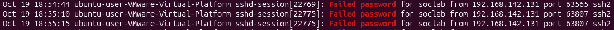
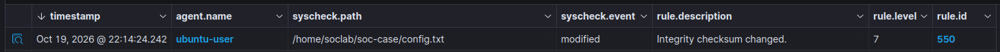
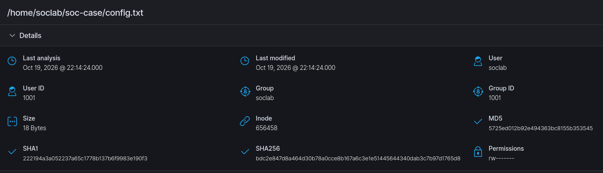

# SOC-001 · Technical notes

The illustrated [SSH brute-force case study is now the repository front page](../README.md). This page holds the configuration and test details behind it.

## Custom correlation rule

The rule was added to `/var/ossec/etc/rules/local_rules.xml` on the Wazuh Manager. The reusable file is [ssh-bruteforce.xml](../rules/ssh-bruteforce.xml).

```xml
<group name="local,sshd,">

  <rule id="100101" level="10" frequency="5" timeframe="20">
    <if_matched_sid>5760</if_matched_sid>
    <same_srcip />
    <description>SOC LAB: SSH brute-force - repeated authentication failures from $(srcip)</description>
    <mitre>
      <id>T1110.001</id>
    </mitre>
    <group>authentication_failures,brute_force,</group>
  </rule>

</group>
```

`if_matched_sid` correlates prior `5760` matches, while `same_srcip` keeps the correlation within one decoded source IP. The short window supports a manual lab burst; it is not a production-tuned threshold. The configuration does not establish the exact number of password prompts used during the test.

References: [Wazuh rule syntax](https://documentation.wazuh.com/current/user-manual/ruleset/ruleset-xml-syntax/rules.html) · [ATT&CK T1110.001](https://attack.mitre.org/techniques/T1110/001/)

## Validation

The lab workflow used:

```bash
sudo /var/ossec/bin/wazuh-analysisd -t
sudo systemctl restart wazuh-manager
sudo /var/ossec/bin/wazuh-logtest
```

These check configuration, apply changes, and evaluate submitted events. The dashboard capture confirms a live `100101` alert with level `10`, source `192.168.142.131`, destination user `soclab`, and location `journald`. Configuration-check output and logtest transcripts were not retained. The commands above document the lab work; they were not run during repository preparation.

### Negative test: text-only procedure

The exact execution and outcome have not been supplied, so this is a repeatable procedure rather than a recorded pass:

1. Let prior correlation state expire, then generate one failed SSH authentication.
2. Inspect the matching time window for the Linux agent and source IP.
3. Confirm the base failure event (`5760`) arrived, then check that `100101` is absent.

An empty custom-alert search is meaningful only after confirming collection of the base event. Slow attempts and distributed sources remain follow-up tests.

## Authentication evidence

Example from the lab notes:

```text
sshd-session[19112]: Failed password for soclab from 192.168.142.131 port 49791 ssh2
```



| Rule | Meaning | Evidence |
|---|---|---|
| `5760` | SSH authentication failed | Dashboard capture |
| `5763` | Built-in SSH brute-force detection | Lab notes |
| `2502` | Password missed more than once | Dashboard capture |
| `5557` | unix_chkpwd password check failed | Dashboard capture |
| `5503` | PAM login failed | Dashboard capture |

Related PAM and SSH records should not automatically be counted as separate password attempts. The dashboard agent name is `ubuntu-user`; the OS hostname is `ubuntu-user-VMware-Virtual-Platform`.

## File integrity monitoring

Inside the Linux agent's `syscheck` configuration:

```xml
<directories check_all="yes" realtime="yes" report_changes="yes">/home/soclab/soc-case</directories>
```

FIM compares recorded metadata and cryptographic hashes. The captured event shows realtime monitoring, changed MD5/SHA-1/SHA-256 hashes, and a size increase from 17 to 18 bytes. With `report_changes` enabled, `syscheck.diff` records the text change from `security=enabled` to `security=disabled`. These are test-file values, not evidence that a real security control was disabled.



Rule `550`, level `7`, reports “Integrity checksum changed.”



Inventory records `soclab` ownership, not the identity of the person who edited the file. SSH and FIM captures also have differing displayed times; timezone settings need reconciliation before asserting a precise sequence. See the [evidence register](../docs/evidence.md).

References: [syscheck configuration](https://documentation.wazuh.com/current/user-manual/reference/ossec-conf/syscheck.html) · [File-change reporting](https://documentation.wazuh.com/current/user-manual/capabilities/file-integrity/use-cases/reporting-file-changes.html)
