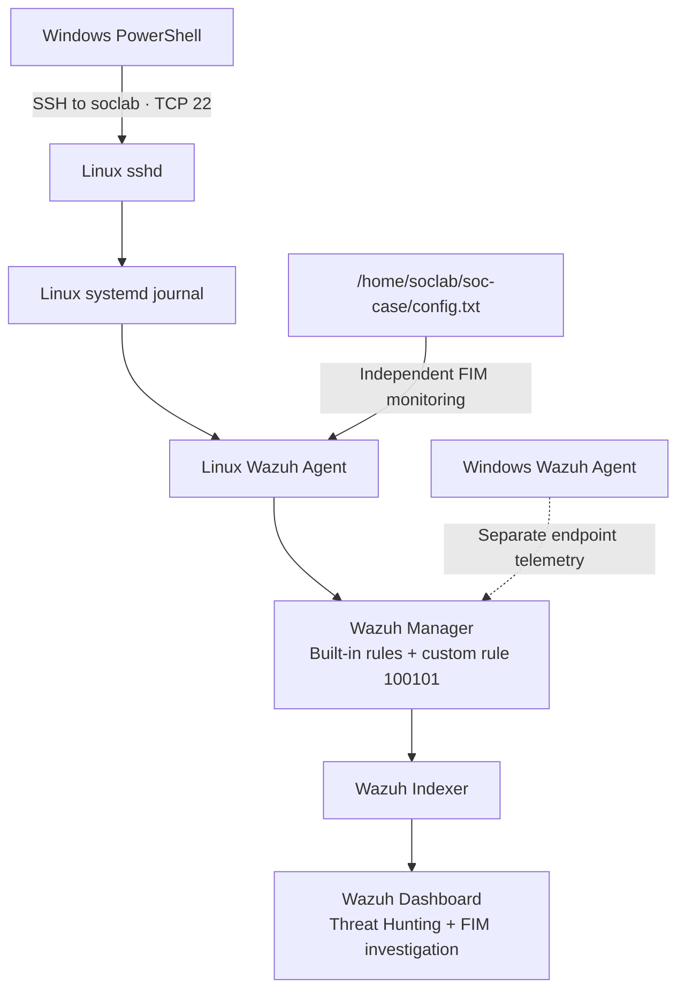

# Lab architecture

Three virtual machines run in VMware Workstation on NAT subnet `192.168.142.0/24`. This is a personal test environment; NAT is not a claim of an air gap.

| Machine | Identity | Role |
|---|---|---|
| Wazuh server | Ubuntu; IP not recorded in the supplied notes | Manager, Indexer, Dashboard; custom rules |
| Linux endpoint | `ubuntu-user-VMware-Virtual-Platform`; `192.168.142.134` | OpenSSH, Wazuh Agent, monitored test directory |
| Windows endpoint | Windows 11; agent `WIN11ENTP-SOC-LAB`; `192.168.142.131` during simulation | PowerShell SSH client and operational Wazuh Agent |



The diagram summarizes the event path rather than every transport component. Authentication records are generated on Linux and analyzed by the manager. File monitoring is a separate input; no automatic SSH-to-FIM correlation rule was configured.

The Linux administrative account is `ubuntu-user`. The separate `soclab` account is the SSH simulation target. File monitoring covers `/home/soclab/soc-case/`.

UFW initially blocked SSH. Allowing TCP 22 from the lab subnet resolved connectivity. The following expresses that allowance; it is a reconstruction, not a captured command transcript:

```bash
sudo ufw allow from 192.168.142.0/24 to any port 22 proto tcp
```

No VM or firewall settings were changed while preparing this repository. Exact Wazuh, Ubuntu, OpenSSH, and VMware versions were not supplied, so version-specific behavior must be confirmed before reproducing the exercise.

[Back to project](../README.md)
